# Hey, I'm Ruturaj 👋

**AI Engineer** who turns LLMs into products people actually use.
About 2 years building AI and data systems in fintech. MS in Information Systems from Northeastern (May '26), and open to **AI Engineer and Forward Deployed Engineer** roles.

### 🚀 What I build
- **RAG systems and AI assistants**: grounding LLMs in real-world data
- **Production backends**: the unglamorous parts that keep AI reliable
- **Domain-first solutions**: starting from the real workflow in financial services, not the model

### 🚀 Featured projects
- **[APMC RAG Assistant](https://github.com/Ruturaj2472/APMC-RAG-Assistant)**: ask questions about agricultural auction receipts and get answers cited to the source records (hybrid BM25 + embedding retrieval)
- **[MeetingAI](https://github.com/Ruturaj2472/Meeting-Summarizer)**: a multi-agent app that turns meeting transcripts into summaries, action items and follow-up drafts (CrewAI, FastAPI, React, Docker)
- **[LangGraph Tavily Agent](https://github.com/Ruturaj2472/LangGraph_Tavily_Agent)**: a LangGraph agent with memory, sentiment routing and human approval backed by durable checkpoints
- **[Agentic RAG Router](https://github.com/Ruturaj2472/langgraph-agentic-rag-router)**: routes each question to the right FAISS knowledge base before answering
- **[DeepEval RAG](https://github.com/Ruturaj2472/DeepEval_RAG)**: scoring a hybrid RAG pipeline on faithfulness, relevancy and hallucination

### 🛠️ Toolbox
- **Languages:** Python, SQL, JavaScript
- **AI and LLM:** LangChain, LangGraph, CrewAI, OpenAI API, Hugging Face, LoRA/PEFT, RAG
- **Evaluation and observability:** DeepEval, RAGAS, MLflow tracing, LLM-as-a-judge, execution-accuracy evals for text-to-SQL, eval-gated CI
- **Retrieval:** Qdrant, ChromaDB, FAISS, BM25, cross-encoder reranking
- **Backend:** FastAPI, Pydantic, React, SQLite
- **Cloud and DevOps:** Docker, AWS EC2, GitHub Actions, Azure Data Factory, Azure Synapse
- **Data:** Snowflake, Power BI, ETL pipelines

### 💼 Where I've been
| Role | Company |
|---|---|
| AI Engineer | Bantosh Agri Fintech |
| Software Engineer | Infinite Computer Solutions |
| Technology Program Analyst | Fiserv |

### 📫 Let's talk
[LinkedIn](https://www.linkedin.com/in/ruturaj-pangavhane) · [Email](mailto:pangavhane.rutu@gmail.com)
